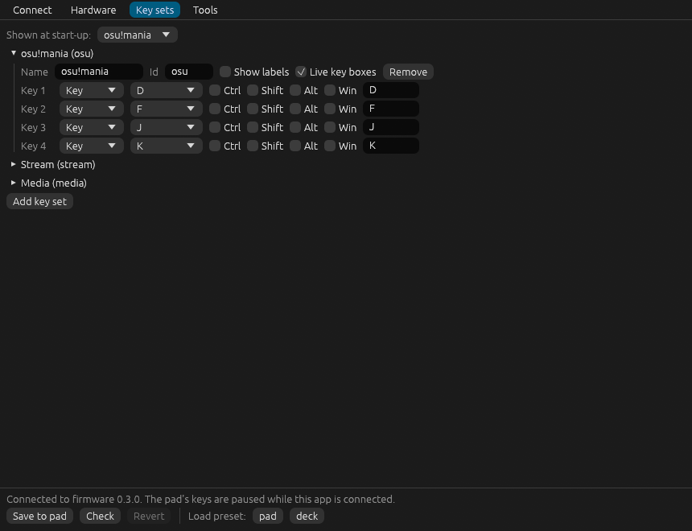

# macropad

A handheld USB macropad for game automation, rhythm games and stream-deck shortcuts.



## Overview

macropad is firmware for a small USB HID pad built on an Arduino Nano ESP32, with mechanical keys, two small buttons and an SSD1306 OLED. It runs automation tools (autoclicker, mouse jitter, key spam, mouse hold) in the background while the keys play osu!mania or act as a stream deck, and a global killswitch stops all output at once. One firmware serves every pad: each pad's pins, buttons, key sets and tools are stored on it and edited with `macropad-config`, a desktop app for Linux and Windows. In use it needs no software on the host: it's a standard keyboard, mouse and media-key device.

## Features

* **Key sets**: up to six sets of key bindings (keys with modifiers, media keys, tool toggles), switched from the menu; the default pad has osu!mania (D, F, J, K), stream (F13 and up, tool toggles) and media sets.
* **Live keys**: a set can show a large `[ ]` per key that fills to `[#]` while held; a low-latency mode shows a static screen instead.
* **Autoclicker**: clicks a mouse button at a random interval between a minimum and a maximum.
* **Jitter**: moves the pointer out and back, then pauses for a random time.
* **Key spam**: presses a chosen key at a random interval.
* **Mouse hold**: holds a mouse button down.
* **Background tools**: tools keep running while you play or use the deck.
* **Global killswitch**: one press stops every key, click and movement; the menu and settings stay usable.
* **Arming**: switch tools on while the killswitch is on, then release the killswitch to start them together.
* **USB safety**: when the computer sleeps or the link drops, the killswitch turns on and armed tools wait for a tap.
* **Settings on the device**: each tool's settings are edited on the OLED and kept across power cycles.
* **Config app**: `macropad-config` edits a pad's wiring, buttons, encoder, key sets and tools, checks the setup on the pad, saves it and confirms the pad restarted with it.
* **Presets as text**: `macropad-config pull` and `push` keep a pad's setup in a TOML file.
* **Recovery**: a pad whose stored setup is unusable starts with keys paused and waits for the app; holding a key while plugging in starts the built-in setup.
* **N-key rollover**: every key can be held at once; chords go out in a single report.
* **Low latency**: a key press reaches USB in about 0.6 ms, and serial is never used while the keys are live.
* **Tests**: native tests for the logic and the record format (shared test vectors with the app), and an on-device self-test that drives the real input pins.
* **Pinned builds**: a `sketch.yaml` profile pins the board core and libraries; the app is pure Rust in a single binary.

## Installation

### Requirements

Firmware:

* [arduino-cli](https://arduino.github.io/arduino-cli/) 1.5 or later, and Make
* g++ for the native tests
* Arduino Nano ESP32
* 128×64 SSD1306 OLED on I2C (address `0x3C`)
* 1 to 8 key switches and up to 2 small push buttons; a rotary encoder with a push button is optional

The profile installs the `arduino:esp32` core and the Adafruit GFX, BusIO and SSD1306 libraries on the first build.

App:

* Rust 1.100 or later, and Make
* A Vulkan, Metal or DirectX 12 driver at run time (on Linux without a GPU, lavapipe from `vulkan-swrast`)
* For the Windows build on Linux: MinGW-w64 and `rustup target add x86_64-pc-windows-gnu`

### Build

```sh
git clone https://github.com/GrunclePug/macropad.git
cd macropad
make
make upload PORT=/dev/ttyACM0
cd client
make build
sudo make install    # optional: installs macropad-config
make windows         # optional: target/x86_64-pc-windows-gnu/release/macropad-config.exe
```

## Usage

Plug the pad into a computer. It starts on its first key set with every tool off.

| Key | Action |
| --- | --- |
| Killswitch, press | Stop all output (red LED) |
| Killswitch, tap while on | Resume; tools that were on start again |
| Killswitch, hold | Switch every tool off |
| Nav, hold | Open the menu; in the menu, go back |
| Nav, tap | On a tool's screen, switch the tool on or off; on a set with live keys, switch between live keys and low latency; in the menu, open the entry |
| Keys 1 and 2 (menu) | Move up and down |
| Keys 3 and 4 (menu) | Open the entry, or go back |
| Keys 1 and 2 (tool screen) | Select a setting |
| Keys 3 and 4 (tool screen) | Decrease or increase it (hold to repeat) |
| Encoder (when fitted) | Scroll and adjust; push to confirm; on a key set, its bindings |

The menu lists Keys (the key sets), the tools, and Configure. A key held through a screen change does nothing until it's released and pressed again.

### The config app

Run `macropad-config` and press Connect. The app asks the pad to switch to config mode; the pad's keys pause while it's connected. Edit the tabs, then Save to pad: the pad checks the setup, saves it, restarts and goes back to work. Check asks the pad without saving, Revert goes back to what was read at Connect, and the presets load the built-in pad or deck setup.

```sh
macropad-config                     # the editor
macropad-config ports               # serial ports, Nano ESP32s first
macropad-config pull pad.toml       # save the pad's setup to a file (refused if the pad can't vouch for one)
macropad-config push pad.toml       # check it on the pad and save it there
macropad-config --fake              # try the editor with a pretend pad
```

The pad can also enter config mode from its menu (Configure), and leaves it with a Kill tap or a Nav hold.

On Linux, ModemManager may probe the pad's serial port. It does no harm, but you can keep it away with a udev rule, for example in `/etc/udev/rules.d/70-macropad.rules`:

```
ATTRS{idVendor}=="2341", ATTRS{idProduct}=="0070", ENV{ID_MM_DEVICE_IGNORE}="1"
```

### Configuration

| Variable | Flag | Default | Description |
| --- | --- | --- | --- |
| `PORT` | `make upload PORT=...` | none | The board's serial device; use the real device (`/dev/ttyACM0`), not a `/dev/serial/by-id/` link |
| `SELFTEST` | `make SELFTEST=1 ...` | unset | Build the on-device self-test instead of the normal firmware |
| | `macropad-config pull/push --port` | the only Nano ESP32 | The pad's serial port |
| `RUST_LOG` | | unset | The app's log level (`info`, `debug`) |

## Setups

A pad's setup is one 1355-byte record: pins, buttons, encoder, key sets, the tools shown in the menu and their settings. The firmware validates it at boot and before saving, and the app shows any error with the field it's in. [docs/protocol.md](docs/protocol.md) describes the record, the error codes and the serial protocol.

* **pad**: 4 keys on D2–D5, Kill on D6, Nav on D7, the osu!mania, stream and media sets, and all four tools.
* **deck**: 8 keys, a bound button sending F21, Nav, an encoder for volume, one set of F13–F20 and no tools.

## Wiring

Every input uses the Nano's internal pull-up and switches to GND. No other parts are needed. Inputs can go on D2–D12, A0, A1, A3, A6 and A7.

| Pin | pad (breadboard) | Planned 8-key build |
| --- | --- | --- |
| D2–D5 | Keys 1–4 | Keys 1–4 |
| D6, D7 | Killswitch, nav | Keys 5–6 |
| D8, D9 | | Keys 7–8 |
| D10, D11 | | Killswitch (or bound button), nav |
| D12, A0, A1 | | Encoder A, B and push |
| A4 (SDA), A5 (SCL) | OLED | OLED |
| 3V3, GND | OLED power | OLED power |

Leave A2 (a boot strapping pin), D0 and D1 free. Keep the Nano's reset button reachable in a case: a double tap on it is the recovery path.

## Self-test

`make SELFTEST=1 upload PORT=/dev/ttyACM0` flashes a build that drives the real input pins low itself, the way the switches do. It starts 3 s after boot and takes about 50 s:

* the arming workflow and key-set switching
* 200 osu presses and 20 chords while jitter and the autoclicker run, with the screen redrawing
* the killswitch with a held key and during clicks
* mouse hold, key spam and saving settings
* a USB disconnect and reconnect

It only sends F13 to F17, mouse button 8 and small pointer moves. Normal mode has no serial output: a full run saves its report and restarts the pad, and the report comes out as `# ` lines the next time the pad enters config mode (by knocking, as the app does). The report is sent again at every config entry until a `TESTACK` command confirms it was read, and it's only valid on the boot right after its run. `TESTRUN` runs the self-test again. Flash the normal build afterwards.

## Development

Firmware, from the repository root:

* Build: `make`
* Test: `make test`
* Flash: `make upload PORT=/dev/ttyACM0`
* Self-test: `make SELFTEST=1 upload PORT=/dev/ttyACM0`
* Hardware checks: `make && make SELFTEST=1`, build the client, then `test/hil/run.sh <USB serial number>` (the script's header says what it does)
* Test vectors: `make vectors`
* Clean: `make clean`

App, from `client/`:

* Run: `make run` (`make run ARGS=--fake` without a pad)
* Test: `make test`
* Lint: `make fmt lint`
* Build: `make build`, `make windows`
* Screenshots: `make screenshots`
* Pure-Rust check: `make nativecheck`
* Clean: `make clean`

## Contributing

Fork the repository and open a pull request.

## License

MIT. See [LICENSE](LICENSE).

## Author

Chad Humphries | [Website](https://grunclepug.com/) | [GitHub](https://github.com/GrunclePug) | [More projects](https://github.com/GrunclePug?tab=repositories)
